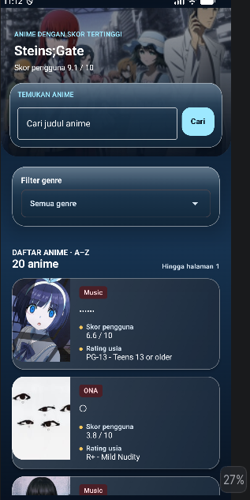
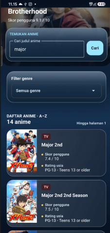
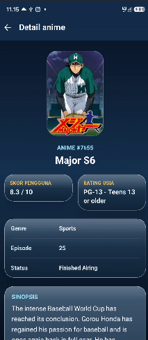

# Nama: Aditya
# NIM : H1D024107
# Shift : G

URL Video: https://youtu.be/LqsdKgDU_vk 
# AnimeResponsi

AnimeResponsi adalah aplikasi Android native untuk melihat daftar anime, mencari judul, memfilter genre, dan membaca detail anime dari Tenrai API. Aplikasi menggunakan Kotlin, Jetpack Compose, Material Design 3, dan pola MVVM dengan tepat dua destination: Home dan Detail.

## Bukti aplikasi

Screenshot 

| Home | Pencarian Major | Detail |
| --- | --- | --- |
|  |  |  |


## Struktur MVVM

```text
app/src/main/java/com/example/animeresponsi/
├── MainActivity.kt                 # Host Compose
├── data/
│   ├── AppContainer.kt             # Dependency injection manual
│   ├── model/                      # DTO respons API dan model UI
│   ├── remote/                     # Retrofit client dan endpoint Tenrai
│   └── repository/                 # Request, mapping null-safe, cache genre
└── ui/
    ├── components/                 # Kartu anime dan poster
    ├── home/                       # HomeScreen, state, HomeViewModel
    ├── detail/                     # DetailScreen, state, DetailViewModel
    ├── navigation/                 # Graph Home dan Detail
    └── theme/                      # Color scheme dan Typography custom
```

Alur event: `Composable → ViewModel → Repository → Tenrai API`. Hasil mengalir kembali melalui `StateFlow` dan dikoleksi dengan `collectAsStateWithLifecycle`, sehingga perubahan state memicu recomposition. Composable tidak memanggil API secara langsung.

## Tenrai API

Base URL: `https://api.tenrai.org/v1/`

| Kebutuhan | Endpoint | Parameter |
| --- | --- | --- |
| List/pencarian/filter | `GET anime` | `q` opsional, `genres` opsional, `page`, `limit=20`, `order_by=title`, `sort=asc` |
| Billboard | `GET top/anime` | `limit=10`, `sfw=true` |
| Genre | `GET genres/anime` | `filter=genres` |
| Detail | `GET anime/{id}` | `id` dari `mal_id` item |

Retrofit melakukan encoding query. Query kosong dan pilihan Semua genre tidak dikirim sebagai parameter. Aplikasi memuat halaman berikutnya sesuai metadata `has_next_page` dari API, tanpa mengklaim seluruh katalog sudah dimuat.

